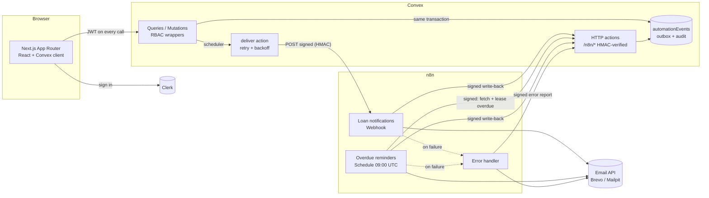
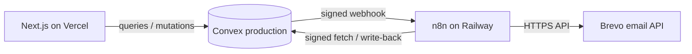

# LendLoop

<!-- Live Demo: https://lendloop-seven.vercel.app/incoming--> 
**Borrow what you need. Lend what you don't.**

A neighborhood tool-lending board. Neighbors list tools, request to borrow them for a date range, and approve, decline or close out loans. n8n handles notifications and daily overdue reminders.

**Stack:** Next.js 16 (App Router) · Clerk · Convex · n8n · TypeScript · Tailwind v4

---

## Contents

1. [Features](#features)
2. [Architecture](#architecture)
3. [Local setup](#local-setup)
4. [Environment variables](#environment-variables)
5. [Roles & access control](#roles--access-control)
6. [n8n integration](#n8n-integration)
7. [Security & data minimization](#security--data-minimization)
8. [Testing](#testing)
9. [Project layout](#project-layout)
10. [Running in production](#running-in-production) (see also [PRODUCTION.md](PRODUCTION.md))

---

## Features

| Area | What you get |
| --- | --- |
| **Public page** (`/`) | Tagline, a read-only list of tools available right now (**name and category only**), and a Clerk "Sign in to lend or borrow" button. |
| **Browse** (`/tools`) | Every listing with its availability (*Available* or *On loan until …*). Filter by category or by "available now". Request to borrow with a date range and an optional note. |
| **My listings** (`/listings`) | Create, edit and delete your own tools (name, category, condition, description). Shows the pending-request count. |
| **My requests** (`/requests`) | Your borrow requests with status, an overdue flag, and the option to cancel before the loan starts. The lender's email is shown **only after approval**. |
| **Incoming** (`/incoming`) | Requests for your tools, grouped into *Waiting for you*, *Lent out & upcoming* and *History*. Approve, decline or mark returned. |
| **Automation activity** (bonus) | Each loan shows recent n8n activity, e.g. "Overdue reminder sent to you 2 days ago" or "Approval notice sent to the borrower 3h ago". |
| **Admin** (`/admin`) | All loans, the member list with a **Trusted Lender** toggle, and an **Automation** health panel (failed deliveries with *Retry*, n8n workflow errors, in-flight items). Admins remove any listing from Browse. |

Business rules, enforced server-side:
- You can't borrow your own tool. Loans last at most 30 days and can be booked at most 90 days ahead.
- Approved loans can't overlap. Approving a request automatically declines other pending requests whose dates overlap (and notifies those borrowers).
- An owner can't delete a tool that's currently lent out. Deleting a listing cancels its open requests and future bookings, and notifies the borrowers.

---

## Architecture



**Key decisions**

- **Convex is the single source of truth and the only place authorization happens.** The Next.js `proxy.ts` (Clerk middleware) only redirects signed-out users to sign in, which is a UX convenience. Every Convex function resolves the caller from the verified Clerk JWT.
- **Transactional outbox for notifications.** The mutation that changes a loan (e.g. `loans.decide`) also inserts an `automationEvents` row and schedules the `notifications.deliver` action, all in one transaction. A notification can't be lost, and none is sent for a change that rolled back.
- **One table for all automation state.** `automationEvents` stores notifications, reminders and n8n workflow errors. Each row has a deterministic idempotency `key`, a status, an attempt count and the last error. The same table powers the per-loan activity feed and the admin health panel.
- **n8n stays thin.** It formats messages, calls the email provider's HTTPS API and owns the schedule. Deciding *who* gets reminded and *whether* a reminder was already sent is Convex's job, so the rules live in one tested place.

### Data model (`convex/schema.ts`)

| Table | Purpose |
| --- | --- |
| `users` | `tokenIdentifier` (from Clerk JWT), email, name, `role` (`admin`/`user`), `trustedLender` |
| `tools` | owner, name, category, condition, description, soft-delete (`removedAt`, `removedBy`) |
| `loans` | tool, owner (denormalized for indexed ownership checks), borrower, `startDate`/`endDate` (ISO dates, UTC, inclusive), note, `status` (`pending → approved → returned`, or `declined` / `cancelled`) |
| `automationEvents` | outbox + audit: `key`, `kind` (`notification`/`reminder`/`workflow_error`), `status` (`pending`/`delivered`/`sent`/`failed`/`skipped`), `attempts`, `leaseUntil`, `lastError`, `n8nExecutionId` |

---

## Local setup

**Prerequisites:** Node 20+ and Docker (for n8n and Mailpit). You also need a free Clerk account. A Convex account is optional, because Convex can run a local backend.

<details><summary>No Docker on macOS? Use Colima (free, command-line only)</summary>

```bash
brew install colima docker docker-compose
mkdir -p ~/.docker && echo '{ "cliPluginsExtraDirs": ["/opt/homebrew/lib/docker/cli-plugins"] }' > ~/.docker/config.json
brew services start colima      # starts now and at login
docker compose version          # sanity check
```
(If `~/.docker/config.json` already exists, add the `cliPluginsExtraDirs` key to it instead of overwriting the file.)
</details>

### 1. Install

```bash
npm install
```

### 2. Convex

```bash
npx convex dev            # choose a cloud dev deployment, or a local one
```

This writes `CONVEX_DEPLOYMENT` and `NEXT_PUBLIC_CONVEX_URL` to `.env.local`. Leave it running in its own terminal, or use `npm run dev` later, which runs it alongside Next.js.

> **Tip: use a local Convex deployment.** `npx convex dev --local`, or `CONVEX_AGENT_MODE=anonymous npx convex dev` with no account, runs the backend on your machine at `127.0.0.1:3210` (with HTTP actions on `:3211`). Convex and n8n can then call each other directly with no tunnel.

### 3. Clerk

1. Create a Clerk application and copy the keys into `.env.local` (see `.env.local.example`):
   ```
   NEXT_PUBLIC_CLERK_PUBLISHABLE_KEY=pk_test_...
   CLERK_SECRET_KEY=sk_test_...
   ```
2. In the Clerk dashboard, enable the **Convex integration**, or create a **JWT template named `convex`**. Make sure the token includes the `email`, `email_verified` and `name` claims, because LendLoop uses them for notifications and the admin allowlist.
3. Point Convex at Clerk, and choose which verified emails get admin on sign-in:
   ```bash
   npx convex env set CLERK_JWT_ISSUER_DOMAIN https://<your-app>.clerk.accounts.dev
   npx convex env set ADMIN_EMAILS you@example.com
   ```

### 4. n8n and Mailpit

```bash
./scripts/setup-secrets.sh     # generates both HMAC secrets + n8n encryption key,
                               # writes .env.n8n, and sets the matching Convex env vars
docker compose up -d
```

- **n8n:** <http://localhost:5678>. Create the owner account on first visit. The first start automatically imports the three workflows and a placeholder "LendLoop Mail API" credential (Mailpit ignores it).
- **Mailpit (inbox for every email sent):** <http://localhost:8025>

Then publish (activate) the two workflows. The error handler doesn't need to be active. Either click **Publish** on each workflow in the n8n UI, or run:

```bash
docker compose exec n8n n8n publish:workflow --id=LLLoanNotify0001
docker compose exec n8n n8n publish:workflow --id=LLOverdueRemind1
docker compose restart n8n
```

> **Using Convex cloud instead of a local backend?**
> - In `.env.n8n`, set `LENDLOOP_CONVEX_SITE_URL=https://<deployment>.convex.site`.
> - Convex cloud can't reach `localhost:5678`. Expose n8n with a tunnel (e.g. `cloudflared tunnel --url http://localhost:5678`) and set `N8N_WEBHOOK_URL=https://<tunnel>/webhook/lendloop-loan-events ./scripts/setup-secrets.sh --force`, or use `npx convex env set N8N_LOAN_EVENTS_WEBHOOK_URL …`.
>
> **On Linux,** a local Convex backend listens on 127.0.0.1, which containers can't reach through `host.docker.internal`. Use a tunnel, or run n8n with `network_mode: host`.

### 5. Run the app

```bash
npm run dev               # Next.js on :3000 + convex dev
```

### 6. See the automations work

| Try this | Expected |
| --- | --- |
| Request a tool, then approve or decline it from another account | Email in Mailpit. The loan's activity shows "… sent to the lender just now". |
| Once an approved loan is past its end date, run the reminders: click **Execute workflow** in n8n, or run `docker compose exec -e N8N_RUNNERS_BROKER_PORT=5690 n8n n8n execute --id=LLOverdueRemind1` | Reminders for overdue loans land in Mailpit. The loan shows "Overdue reminder sent …". Running it again the same day sends nothing new. |
| `docker compose stop mailpit`, then trigger a notification | n8n retries 3× and then reports `failed` to Convex. It appears under **Admin → Automation → Failed deliveries**. |
| `docker compose stop n8n`, then trigger a notification | Convex retries with backoff (30s, 2m, 8m, 32m), then marks it `failed`. Admins can **Retry** it once n8n is back. |
| Break `LENDLOOP_CONVEX_SITE_URL` and run reminders | The HTTP node retries, the run fails, and the **error workflow** posts to Convex (**Admin → Automation → n8n workflow errors**) and emails `LENDLOOP_OPS_EMAIL`. |

> When running `n8n execute` inside the running container, the extra `N8N_RUNNERS_BROKER_PORT` avoids a port clash with the live instance. The "Python task runner" warning it prints is harmless, because these workflows only use JavaScript.
>
> The error workflow fires only for **production executions** (triggered by the webhook or the schedule), not for manual test runs inside the editor. That is how n8n works.

---

## Environment variables

**Next.js** (`.env.local`, see `.env.local.example`)

| Name | Description |
| --- | --- |
| `NEXT_PUBLIC_CONVEX_URL` | Convex client URL (written by `convex dev`) |
| `CONVEX_DEPLOYMENT` | Deployment used by the CLI (written by `convex dev`) |
| `NEXT_PUBLIC_CLERK_PUBLISHABLE_KEY` / `CLERK_SECRET_KEY` | Clerk API keys |

**Convex deployment** (`npx convex env set …`, never committed)

| Name | Description |
| --- | --- |
| `CLERK_JWT_ISSUER_DOMAIN` | Clerk Frontend API URL. Used by `convex/auth.config.ts` to verify JWTs. |
| `ADMIN_EMAILS` | Comma-separated emails that are promoted to admin on sign-in, **only if Clerk marks them verified**. |
| `N8N_LOAN_EVENTS_WEBHOOK_URL` | n8n production webhook URL (`…/webhook/lendloop-loan-events`). If unset, notifications are recorded as `skipped`. |
| `LENDLOOP_TO_N8N_SECRET` | HMAC secret Convex uses to sign webhooks to n8n |
| `N8N_TO_LENDLOOP_SECRET` | HMAC secret Convex uses to verify calls from n8n |

**n8n** (`.env.n8n`, see `.env.n8n.example`)

| Name | Description |
| --- | --- |
| `N8N_ENCRYPTION_KEY` | Encrypts n8n's stored credentials |
| `LENDLOOP_TO_N8N_SECRET` / `N8N_TO_LENDLOOP_SECRET` | The same two secrets as on Convex |
| `LENDLOOP_CONVEX_SITE_URL` | Convex HTTP actions base URL, as seen from the n8n container |
| `LENDLOOP_APP_URL` | Base URL for links in emails |
| `LENDLOOP_MAIL_FROM`, `LENDLOOP_OPS_EMAIL` | Sender address (`Name <email>` or a bare address), and the recipient of failure alerts |
| `LENDLOOP_MAIL_API` | Email provider: unset = Mailpit's send API (local), `brevo` = Brevo's transactional API (production) |
| `LENDLOOP_MAILPIT_URL` | Optional override for the Mailpit send endpoint (default `http://mailpit:8025/api/v1/send`) |

**Email goes over HTTPS, not SMTP.** Some hosting plans block outbound SMTP, and a blocked SMTP connection can hang instead of failing. Each workflow's "Compose" step builds a provider-specific request and a single HTTP node sends it, with a 15s timeout and 3 tries. A failure goes down the same `failed` path as before.

The Brevo API key is stored only in the n8n **Header Auth** credential "LendLoop Mail API" (header `api-key`), never in the workflow JSON. The bundled credential is a placeholder for Mailpit, which ignores the header. In production, open that credential and paste your Brevo API key (`xkeysib-…`). Its sender must be verified in Brevo.

---

## Roles & access control

Authorization is enforced **in Convex functions**. The UI only hides buttons a user can't use.

- `convex/lib/auth.ts` defines `userQuery`, `userMutation`, `adminQuery` and `adminMutation`, built on `convex-helpers` custom functions. They resolve `ctx.viewer` from `ctx.auth.getUserIdentity()`, which is the verified Clerk JWT. **No function accepts a user id from the client.**
- Resource-level checks sit next to the data access, using `assertAllowed(...)`:

| Action | Who | Where |
| --- | --- | --- |
| List / edit a tool | the owner only (admins moderate by removing, not editing) | `tools.create`, `tools.update` |
| Delete / remove a tool | the owner, or any admin | `tools.remove` |
| Request to borrow | any user, except for their own tool | `loans.request` |
| Approve / decline / mark returned | the tool's owner | `loans.decide`, `loans.markReturned` |
| Cancel a request | the borrower | `loans.cancel` |
| My requests / Incoming | rows where you are the borrower / the owner, read via indexes on your own id | `loans.myRequests`, `loans.incoming` |
| View all loans, member list, Trusted Lender, automation health, retry | admins | `admin.*` |
| n8n callbacks, role changes | **internal** functions only. These are unreachable from clients and are called by HMAC-verified HTTP actions or the CLI. | `reminders.*`, `notifications.recordDeliveryReport`, `admin.recordWorkflowError`, `users.setRole` |

**How admins are created.** The role is never taken from the client. A user is promoted only when their **verified** email is in `ADMIN_EMAILS` (useful for bootstrapping), or by an operator:

```bash
npx convex run users:setRole '{"email":"someone@example.com","role":"admin"}'
```

Promotion through the allowlist never demotes anyone. Demotion is an explicit `setRole`.

---

## n8n integration

Workflow exports live in [`n8n/workflows/`](n8n/workflows/):

| File | Trigger | What it does |
| --- | --- | --- |
| `lendloop-loan-notifications.json` | Webhook `POST /webhook/lendloop-loan-events` | Verifies the HMAC → responds 202 (or 401) → composes the email for that event type → sends it via the email API (15s timeout, 3 tries) → posts a signed `sent`/`failed` write-back to Convex (3 tries). |
| `lendloop-overdue-reminders.json` | Schedule, daily 09:00 UTC (plus a manual trigger) | Signed `POST /n8n/overdue-loans` → one item per reminder → email (3 tries) → signed write-back to `/n8n/reminder-status` (3 tries). |
| `lendloop-error-handler.json` | Error Trigger (set as the error workflow for both workflows above) | Builds a metadata-only error report → signed `POST /n8n/workflow-error` **and** an email to `LENDLOOP_OPS_EMAIL`. Each path continues even if the other fails. |

### Signing protocol (both directions)

```
X-LendLoop-Timestamp: <unix ms>
X-LendLoop-Signature: sha256=<hex HMAC-SHA256(secret, "<timestamp>.<raw body>")>
```

- The receiver recomputes the HMAC over the **raw body** and compares in constant time. It rejects requests whose timestamp is more than ±5 minutes off, which limits replays. Because every endpoint is idempotent, a replay inside that window does no harm.
- Each direction has its **own secret**. A leaked n8n-side secret can't be used to forge webhooks *to* n8n, and vice versa.
- Convex HTTP endpoints also cap body size (16 KB) and strictly validate the JSON body against the same Convex validators the internal mutation uses (unknown fields → 400). They return generic error codes and log details server-side only.

### Reliability and idempotency

| Concern | How it's handled |
| --- | --- |
| Lost notifications | Transactional outbox (row + scheduled action are committed with the state change) |
| Convex → n8n failures | `deliver` retries 5xx/408/429/timeouts/network errors with exponential backoff and jitter (5 attempts). Other 4xx fail fast, because a bad signature won't fix itself. The final state is `failed` with `lastError`, visible in Admin with a **Retry** button. |
| Duplicate notifications | Deterministic key `notif:<loanId>:<event>`, and each transition happens once. Write-backs are keyed on it and never regress a `sent` row. Delivery is *at-least-once*, see [PRODUCTION.md](PRODUCTION.md). |
| Duplicate reminders | Key `reminder:<loanId>:<YYYY-MM-DD>`, at most one per loan per day. `/n8n/overdue-loans` **leases** each reminder to the calling execution for 15 minutes, so a concurrent or repeated run gets nothing. If a run crashes before writing back, the lease expires and the next run retries (max 3 attempts per day). A loan already marked `sent` is never returned again that day. |
| n8n step failures | Every HTTP and email node has `retryOnFail` (3 tries, 5 s apart). Email failures go down an error branch that writes back `failed`, so the outcome is recorded rather than lost. |
| Whole-run failures | `settings.errorWorkflow` → error handler → recorded in Convex and emailed to ops. |
| Unknown keys on write-back | 404, so the failure shows up in n8n rather than being silently ignored |

---

## Security & data minimization

**Security**
- Authorization is enforced in Convex on every call (see above), and covered by tests in `tests/backend.test.ts`.
- Identity comes only from the verified Clerk JWT (`auth.config.ts` pins the issuer and `applicationID: "convex"`).
- The admin allowlist requires `email_verified`. An unverified email that matches the allowlist is not promoted (tested).
- Every n8n-facing endpoint is an `httpAction` with HMAC + timestamp verification and strict schema validation. The mutations behind them are `internal` and not callable from browsers.
- Secrets live only in Convex env vars, `.env.n8n` (git-ignored, created `chmod 600` by the setup script) and n8n's encrypted credential store. The exported workflow JSON references `$env.*` and a credential **id/name** only. A test asserts that no secrets appear in the exports.
- Input limits are enforced server-side (name, description and note lengths; date validity; loan length).
- Next.js sends basic hardening headers (`nosniff`, `X-Frame-Options: DENY`, referrer policy, permissions policy). `poweredByHeader` is off.
- Docker ports bind to `127.0.0.1` only.

**Data minimization**
- **Public page:** tool `name` and `category` only. No owner, description or condition (tested).
- **Signed-in browsing:** shows the owner's **first name** and Trusted badge, never an email.
- **Contact details** (email) are revealed to the other party **only once a loan is approved**, and only on that loan.
- **Webhook payload to n8n** contains exactly: event id and type, timestamp, the **recipient's** email and first name, the **other party's first name**, tool name, and dates. It excludes user ids, the other party's email, the request note, the tool description and roles (tested).
- **Overdue endpoint** returns the borrower's email and first name, the lender's first name, tool name, due date and days overdue. Nothing else.
- **Error reports** from n8n carry workflow and execution metadata and the error message (truncated to 500 characters), never the failed run's input data.
- **n8n execution data** (which contains recipient emails) is pruned after 7 days (`EXECUTIONS_DATA_MAX_AGE=168`).
- The **automation log** stores status and error text, not message bodies or email addresses.

---

## Testing

```bash
npm test          # vitest: 25 tests
npm run lint
npm run typecheck
```

- `tests/backend.test.ts` runs the real Convex functions in-memory with `convex-test`. It covers RBAC for every role and action, public-data minimization, contact reveal after approval, double-booking protection, webhook signing and payload contents, retry/backoff → `failed`, reminder leasing, idempotent write-backs, and rejection of unsigned or malformed HTTP calls.
- `tests/n8n-workflows.test.ts` **executes the JavaScript inside the exported n8n Code nodes** against the Convex signer and verifier, so the two sides can't drift apart. It also checks the exports for hygiene: no secrets, the error workflow is wired up, and every external call retries.

---

## Project layout

```
app/
  page.tsx                 public landing page
  (app)/layout.tsx         signed-in shell: nav, user upsert, auth-state handling
  (app)/tools|listings|requests|incoming|admin/page.tsx
components/                UI primitives, loan status + activity feed
convex/
  schema.ts, validators.ts
  lib/auth.ts              RBAC wrappers + assertions
  lib/hmac.ts              signing/verification (Web Crypto)
  lib/domain.ts            categories, limits, date helpers (shared with the UI)
  model/tools.ts           availability logic
  tools.ts, loans.ts, users.ts, admin.ts
  notifications.ts         outbox + delivery to n8n
  reminders.ts             overdue lease + write-back
  http.ts                  signed n8n endpoints
n8n/workflows/*.json       exported workflows
n8n/credentials/           placeholder email-API credential (no secret)
docker-compose.yml         n8n + Mailpit + one-shot importer
scripts/setup-secrets.sh   generates and distributes the shared secrets
proxy.ts                   Clerk middleware (Next 16 name for middleware.ts)
```

---

## Running in production

See **[PRODUCTION.md](PRODUCTION.md)** for what I'd change.

### Deploying to production

The hosted version runs on four services. Each one keeps its own secrets. Nothing is shared through the repo.



**1. Convex (production deployment).** In the Convex dashboard, switch the project to **Production** and set these environment variables *before* the first deploy (`auth.config.ts` needs the Clerk issuer):

| Variable | Value |
| --- | --- |
| `CLERK_JWT_ISSUER_DOMAIN` | Clerk Frontend API URL |
| `ADMIN_EMAILS` | verified emails to promote to admin |
| `LENDLOOP_TO_N8N_SECRET` / `N8N_TO_LENDLOOP_SECRET` | new values from `openssl rand -hex 32` (never reuse local ones) |
| `N8N_LOAN_EVENTS_WEBHOOK_URL` | `https://<n8n-host>/webhook/lendloop-loan-events` (until set, notifications are recorded as `skipped`) |

Then generate a **Production Deploy Key** (Settings → URL & Deploy Key) for Vercel.

**2. Vercel.** Import the GitHub repo. Don't add the marketplace Convex or Clerk integrations, because they create new projects. Set:

- **Build Command:** `npx convex deploy --cmd 'npm run build'`. This pushes Convex functions and injects `NEXT_PUBLIC_CONVEX_URL` into the build.
- **Environment variables:** `CONVEX_DEPLOY_KEY`, `NEXT_PUBLIC_CLERK_PUBLISHABLE_KEY`, `CLERK_SECRET_KEY`.

Every push to `main` deploys both the frontend and the Convex functions.

**3. n8n (Railway, Docker image `n8nio/n8n:<version>`).** Convex's cloud must be able to reach the webhook, so n8n needs a public HTTPS URL.

- Attach a **volume** at `/home/node/.n8n`. Without it, workflows and credentials are lost on every redeploy.
- Generate a domain on port `5678`.
- Set the variables from [`.env.n8n.example`](.env.n8n.example) with production values, plus:

| Variable | Why |
| --- | --- |
| `WEBHOOK_URL=https://<n8n-host>/` | so n8n shows (and registers) public webhook URLs |
| `N8N_PROXY_HOPS=1` | n8n sits behind Railway's proxy |
| `LENDLOOP_MAIL_API=brevo` | send email through Brevo's HTTPS API |
| `LENDLOOP_CONVEX_SITE_URL=https://<deployment>.convex.site` | the Convex **site** URL (HTTP actions), not `.convex.cloud` |
| `RAILWAY_RUN_UID=0` and `N8N_USER_FOLDER=/home/node` | Railway volumes are root-owned. Running as root lets n8n write to the volume, and `N8N_USER_FOLDER` keeps the data *on* the volume (as root, n8n would otherwise use `/root/.n8n`). |
| `N8N_BLOCK_ENV_ACCESS_IN_NODE=false`, `NODE_FUNCTION_ALLOW_BUILTIN=crypto` | Code nodes read the HMAC secrets and use Node's `crypto` |

Changes in Railway are staged. Click **Deploy** to apply them.

Then, in the n8n UI:
1. Create a **Header Auth** credential named **LendLoop Mail API** with header `api-key` and your Brevo **API** key (`xkeysib-…`, not the SMTP key).
2. Import the three files from `n8n/workflows/`, error handler first.
3. Select that credential in each send node, set **Settings → Error workflow** on the two main workflows, then **Publish** them.

**4. Brevo.** Verify the sender address used in `LENDLOOP_MAIL_FROM`. Under **Security → Authorized IPs**, leave IP blocking **off for API keys**, because Railway's egress IP isn't fixed.

**Smoke test**
- An unsigned `POST` to the webhook must return **401**.
- **Execute** "Overdue reminders" in n8n. "Fetch overdue loans" turning green proves n8n→Convex signing works.
- A real borrow request should email the lender and show "… sent just now" on the loan.
